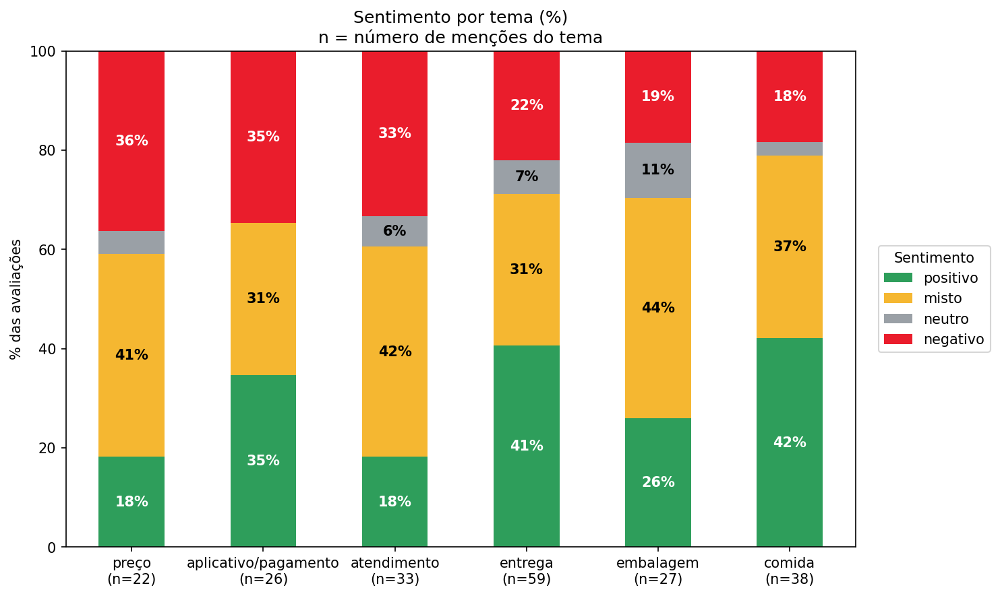
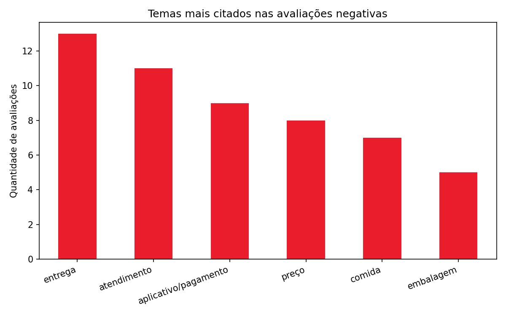
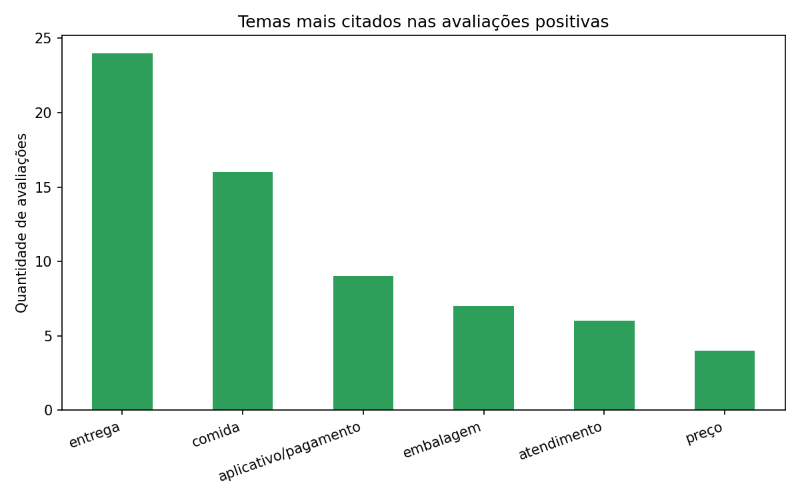

# Analisador de Avaliações com IA

Pipeline em Python que usa um LLM para classificar o **sentimento** (positivo, negativo, misto ou neutro) e os **temas** (entrega, comida, preço, atendimento, embalagem, aplicativo/pagamento) de avaliações de clientes de um app de delivery, e mede o quanto a IA concorda com um gabarito.

> Os dados são **sintéticos**: as 120 avaliações foram geradas por uma IA a partir de situações e estilos sorteados pelo código. Os resultados não representam clientes reais.

## O que o projeto faz

1. `gerar_avaliacoes_v3.py` gera 120 avaliações fictícias, com o gabarito de sentimento de cada uma
2. `analisador.py` envia cada avaliação ao LLM, pedindo resposta em JSON, e salva em `resultados_v3.csv`
3. Compara a resposta da IA com o gabarito e salva as divergências em `divergencias.csv`
4. `grafico.py` e `proporcao.py` geram os gráficos abaixo

## Resultados

A IA concordou com o gabarito em **108 de 120 avaliações (90%)**.

| Gabarito | Concordância |
|---|---|
| Negativo | 35 de 35 |
| Misto | 35 de 35 |
| Positivo | 29 de 30 |
| Neutro | 9 de 20 |

Dos 12 casos em que houve divergência, 10 foram avaliações neutras classificadas como positivas: o modelo tende a ler "sem problemas" e "tudo conforme o esperado" como elogio.

## Tecnologias

- Python, pandas, matplotlib
- API da Groq (modelo `openai/gpt-oss-120b`), acessada pela biblioteca `openai` (o formato é compatível, então dá para trocar de provedor mudando poucas linhas)
- Engenharia de prompt para obter saída estruturada em JSON

## Como rodar

1. `pip install -r requirements.txt`
2. Crie um arquivo `.env` com sua chave: `GROQ_API_KEY=sua_chave`
3. `python analisador.py` e depois `python grafico.py` e `python proporcao.py`

## O que aprendi

- Pedir só "elogio ou reclamação" era simples demais, porque muitas avaliações têm os dois lados. Passei a classificar em sentimento + temas.
- Contar quantas vezes um tema aparece não mostra onde está o problema: comida e entrega apareciam muito em tudo. A proporção por tema mostrou o quadro real.

## Limitações

- O gabarito veio de outra IA, então os 90% medem **concordância**, não precisão absoluta. Ao revisar as divergências, o caso 28 ("pedido atrasou, mas o suporte resolveu") parece misto, ou seja, o erro foi do gabarito. Vários dos neutros são discutíveis até para uma pessoa.
- Os exemplos mistos quase sempre usam "mas/porém", o que facilita para a IA. Os negativos eram diretos. O teste só ficou realmente difícil nos neutros.
- Algumas situações se repetem (por exemplo, reembolso demorado) e o texto sintético soa artificial em alguns casos.
- Amostra pequena (120): as porcentagens por tema, principalmente de temas com poucas menções, mudam muito com uma avaliação a mais ou a menos.
- Como os dados são sintéticos e os temas foram sorteados pelo código, os gráficos demonstram o pipeline, não conclusões sobre o comportamento de clientes reais.

## Próximos passos

- Melhorar a definição de "neutro" no prompt e testar em exemplos diferentes dos usados para avaliar
- Gerar mistos sem conectivos óbvios e mais situações distintas
- Testar com avaliações reais de uma base pública